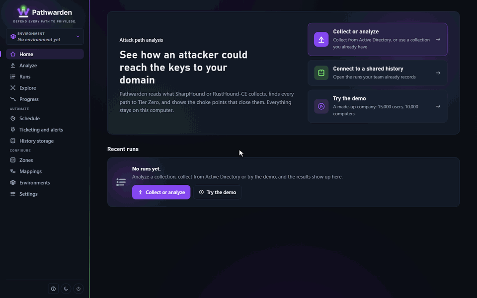

<p align="center">
  
</p>

# Pathwarden

Pathwarden is free, open-source attack path management for Active Directory
and Entra ID. It finds every attack path to Tier Zero, ranks the findings,
lists the fewest changes that cut them all, and tracks each finding from run
to run until it is fixed. It is one executable for Windows or Linux, with an
app and a command line that do the same things.

Piloted in production for a month in a large multi-forest, multi-tenant environment mixing Active Directory and Entra ID: 2.3 million objects, with a peak of 6.2 GB of memory.

## What sets it apart

- **A collector that is safe in production.** The built-in collector signs
  in to computers with Kerberos only, over signed SMB. A
  [least-privilege collector GPO](docs/collector-account.md) lets it read
  local administrators without being an administrator anywhere.
- **A run history you share through git.** Runs, settings and accepted
  risks, with who accepted them, travel through a git repository you
  choose. The history can be encrypted with a passphrase
  ([scheduled runs](docs/running.md)).
- **Tickets that follow the findings.** The ServiceNow and Jira plugins
  open a ticket for a new finding, close it when the finding is fixed and
  reopen it when the finding comes back ([plugins](docs/plugins.md)).
- **AD, AD CS and Entra ID in one graph.** Group memberships, permissions,
  sessions, delegation, GPOs, trusts, AD CS (ESC1 to ESC11 and ESC13)
  and the hybrid links to Entra ID ([rules](docs/rules.md), [Entra ID](docs/entra.md)).
- **The remediation path.** A minimum cut of the graph: the smallest set of
  changes that leaves no account outside Tier Zero with a path into it.
  Every rule has a step-by-step guide with PowerShell, verification and
  rollback.

It reads SharpHound, RustHound-CE and AzureHound collections, OpenGraph
files and PingCastle reports, or collects the data itself
([collecting](docs/collect.md)).

> Only collect and analyze environments you are authorized to assess.
> Collector output is sensitive: store it like credentials.



## Quick start

Download the Windows or Linux release from the
[releases page](https://github.com/marbas207/Pathwarden/releases). On Linux,
`pathwarden ui` opens the app in your browser; the desktop window is Windows
only.

### In the app

1. Run `pathwarden ui`.
2. Click **Try the demo**.

### On the command line

```sh
pathwarden demo                    # writes the demo company's report
pathwarden findings -i demo:       # any analysis command reads the demo
pathwarden collect --domain scale.local --output ./collect
pathwarden report -i ./collect -o report.html
```

The demo is a synthetic company, SCALE.LOCAL, built into the executable.
See the [sample report](docs/sample-report.html).

## Documentation

- [Documentation index](docs/README.md).
- [Getting started](docs/getting-started.md) and
  [tasks, step by step](docs/tasks.md).
- [Coverage comparison](docs/coverage.md) with BloodHound Enterprise and
  BloodHound CE.
- [How it works](docs/how-it-works.md) and the [rules](docs/rules.md).
- For developers and reviewers: [building](docs/dev/building.md),
  [threat model](docs/dev/threat-model.md) and
  [file formats](docs/dev/formats.md).
- [Roadmap](ROADMAP.md).
