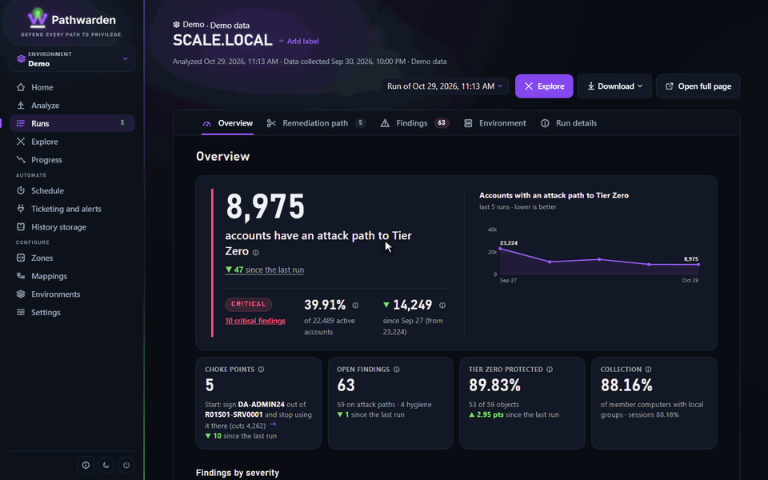

# Evidence packs for auditors

An evidence pack is a signed zip that shows an auditor a finding was open in
one run and is gone in a later collection. Anyone can check it hasn't been
changed, without trusting the person who hands it over.

## Build an evidence pack



### In the app

1. Open a run page.
2. Click **Download** › **Evidence pack…**.

The pack compares the run with an earlier run of the same environment. The
app signs it with this computer's key; **Settings** › **Evidence signing
key** shows its fingerprint.

Runs loaded from a shared history get no pack, and are never the run
compared with: this computer didn't make them, so it doesn't sign for
them. Make the pack on the computer that recorded the run.

### On the command line

```powershell
# Once: create the key, then publish its fingerprint
pathwarden evidence keygen --output C:\pathwarden\evidence-key

# After the fix: collect again, then build a pack for the finding
pathwarden evidence -i .\collect -c pathwarden.toml `
    --finding PW-003-39f2ede7c479090b --key C:\pathwarden\evidence-key

# Or from runs of the app
pathwarden evidence --run 20261010T083000.123Z --env Demo
```

`pathwarden evidence` retests like `pathwarden retest`, against the run
history or a `--baseline`, and records nothing. Without `--finding` or
`--rule`, it covers every open finding. Its exit status is the retest's,
and it writes the pack even when findings are still open.

More: `pathwarden evidence --help`.

## What is in a pack

| File | Contents |
|---|---|
| `README.txt` | What the pack shows and how to check it. |
| `metadata.json` | Pathwarden's version and both sides of the retest, with the collector files' hashes. |
| `retest.json` | The verdicts, as `pathwarden retest --json` gives them. |
| `findings.json` | Each finding before and after. |
| `history.json` | The run history since the earliest finding was first seen. |
| `report.html` | The HTML report. Not in a redacted pack. |
| `manifest.json` | The SHA-256 and size of every file, and the signer's public key. |
| `manifest.json.minisig` | The Ed25519 signature of `manifest.json`. |

A full pack holds names, so share it like the report. `--redact` leaves out
the report and every object, domain and file name, and Pathwarden refuses to
write a redacted pack in which it still finds one.

## Keys

`keygen` writes `evidence.key`, the secret key, and `evidence.pub`, the
public key. Only the current account can read the folder. In a pipeline, put
the last line of `evidence.key` in the `PATHWARDEN_EVIDENCE_KEY` variable.

`keygen` prints the key's fingerprint (`SHA256:` and 43 characters).
Publish it once, outside the pack: in the contract, on your website or in a
signed email. If the key leaks, make a new one and publish its fingerprint.

## Verify a pack

### In the app

1. Click **Settings**.
2. Under **Check an evidence pack**, upload the zip.

### On the command line

```powershell
pathwarden evidence verify pack.zip --fingerprint SHA256:NSrf3sUN38/MMY7n/4oyfdbfNmH+cYTZiKVry8z3MkA
```

Exit status 0 means verified, 1 not verified (each problem is listed), 2 an
error, and 3 intact but with no `--fingerprint` or `--key` to check the
signer. `scripts/verify_evidence.py` makes the same checks with Python 3
alone (`python3 -I verify_evidence.py pack.zip --fingerprint SHA256:...`).

The signature doesn't prove when the pack was made, or that the collection
was complete; can't tell verdicts guard against an incomplete collection.

## The format

For anyone writing their own verifier.

**Pack.** A zip or folder of plain files: exactly the files `manifest.json`
lists, plus `manifest.json` and `manifest.json.minisig`. Names are relative
and `/`-separated, with no `.`, `..`, `\`, `:` or empty parts, each once.

**`manifest.json`** (UTF-8):

```json
{
  "schema": "pathwarden.evidence.v1",
  "created_at": 1791621000,
  "created": "2026-10-10T08:30:00Z",
  "pathwarden": "0.1.0",
  "redacted": false,
  "signer": {
    "algorithm": "ed25519 (minisign legacy \"Ed\")",
    "public_key": "RWQ1Kt/exQ3fz0xH...",
    "fingerprint": "SHA256:NSrf3sUN38/MMY7n/4oyfdbfNmH+cYTZiKVry8z3MkA"
  },
  "summary": { "baseline": {}, "after": {}, "counts": {}, "verdicts": [], "selection": {} },
  "files": [
    { "path": "retest.json", "sha256": "<64 lowercase hex>", "bytes": 5178 }
  ]
}
```

**Public key.** Base64 (standard, padded) of 42 bytes: `"Ed"` (0x45 0x64),
an 8-byte key ID (the first 8 bytes of SHA-256 of the public key) and the
32-byte Ed25519 public key. The `.pub` file is `untrusted comment: <text>`
and then that base64.

**Fingerprint.** `SHA256:` and the unpadded base64 of SHA-256 of the 32-byte
public key.

**`manifest.json.minisig`**, exactly four lines, each ending in `\n`:

```
untrusted comment: signature from Pathwarden evidence key <fingerprint>
<base64 of "Ed" ‖ key ID (8 bytes) ‖ Ed25519 signature of manifest.json (64 bytes)>
trusted comment: <comment>
<base64 of the Ed25519 signature of (the 64-byte signature ‖ the comment's UTF-8 bytes)>
```

Both are plain Ed25519 (RFC 8032) signatures by the same key: minisign's
legacy format.

**To verify:**

1. Take the publisher's key, or the manifest's `signer.public_key` checked
   against the published fingerprint.
2. Check that the signature's key ID is the key's, then both signatures.
3. Check that the signature file equals the four lines rebuilt from its
   parts.
4. Check each listed file's SHA-256 and size, and that no other file is in
   the pack.
5. For a `.zip`, check that each file's own (local) header gives the same
   name, flags, method, CRC and sizes as the zip's directory, and that the
   files sit end to end from the start of the zip to its directory. Otherwise
   another zip tool could show other files than the ones you checked.
