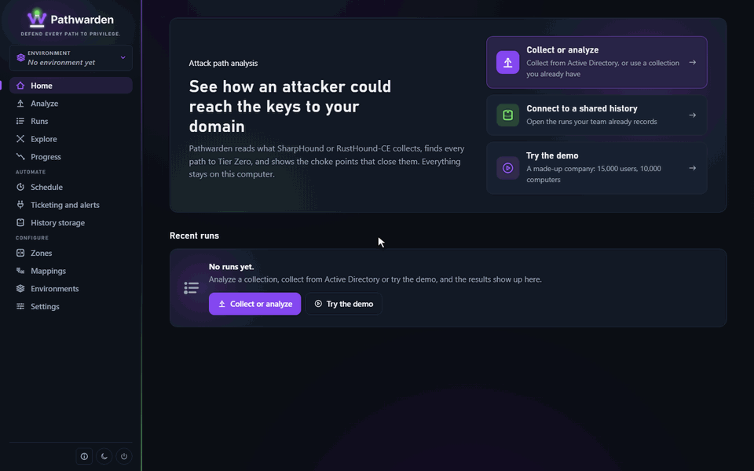
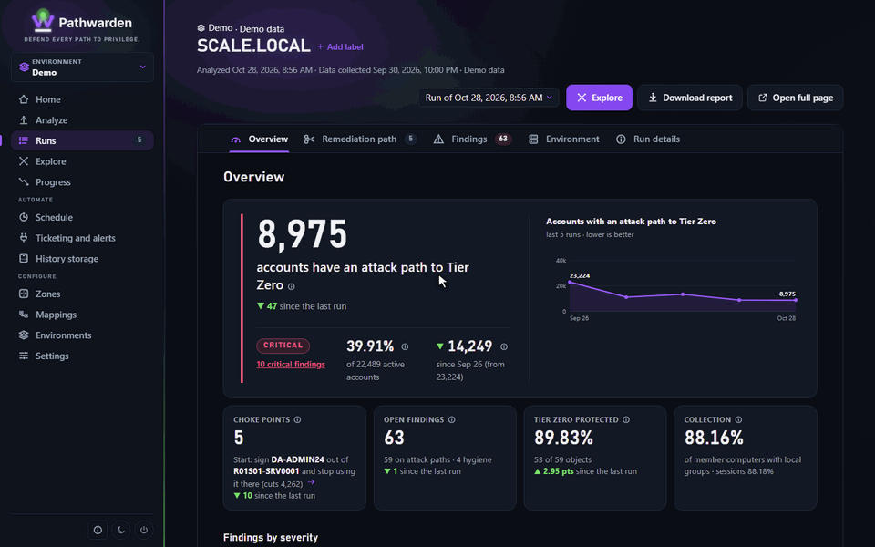

# Getting started

Install Pathwarden, try the demo, collect your domain, read the report and
schedule runs.

## 1. Install

Pathwarden is one executable. The **full** variant collects from your
domain itself; the **lean** one analyzes SharpHound or RustHound-CE files.

1. On Windows, download a zip from the
   [releases page](https://github.com/marbas207/Pathwarden/releases) and
   [verify it](dev/building.md#verifying-a-download). The executables are
   Authenticode-signed.
2. Unzip `pathwarden.exe` anywhere. The ServiceNow and Jira plugins go next
   to it.

On Linux, [build from source](dev/building.md) for now; Linux releases come
with 1.0.0-rc.2. There is no desktop window on Linux: `pathwarden ui` opens
the app in your browser.

## 2. Try the demo

The demo is SCALE.LOCAL, a made-up company of 10,000 computers and 15,000
users, with five runs a week apart.



### In the app

1. Run `pathwarden ui`.
2. On **Home**, click **Try the demo**.
3. Wait for the analysis to finish. The run page opens on **Overview**.

### On the command line

```sh
pathwarden demo -o demo-report.html
```

`-i demo:` reads the demo collection in any command.

## 3. Collect your domain

Only collect from environments you're authorized to assess. A collection
is a map of your domain for an attacker: store it like credentials and
delete it after analysis.

Follow [Collect from Active Directory](tasks.md#collect-from-active-directory),
or, for files SharpHound or RustHound-CE wrote,
[Analyze a collection](tasks.md#analyze-a-collection). Ports, accounts and
what each method sees are in [Collecting](collect.md).

## 4. Read the report



| Tab | What it shows |
|---|---|
| **Overview** | How many accounts have an attack path to Tier Zero, Tier Zero's status, and **What changed** since the last run. |
| **Remediation path** | The smallest set of changes that cuts every path, most effective first. |
| **Findings** | Every finding by rule, with its attack path and a step-by-step guide. |
| **Collection** | Privilege Zones, collection completeness, trusts and data sources. |

Click the ⓘ beside a number for what it means. If the **Collection** card
shows few computers with sessions or local groups, paths through them are
missing: run a Full collection.

On the command line: `pathwarden posture`, `findings`, `plan` and `report
-o report.html`, each with `-i` and the collection.

## 5. Schedule runs

Follow [Schedule nightly runs](tasks.md#schedule-nightly-runs). Each run
tracks findings (new, fixed, back) in a run history and can open tickets in
ServiceNow or Jira. To open a run history teammates already record, run
`pathwarden env create --from-git <repository URL> --use`, or start the app
with `pathwarden ui --allow-destinations` and click **Connect to a run
history** on **Home**.

More: [Running Pathwarden](running.md), [Tasks, step by step](tasks.md).
