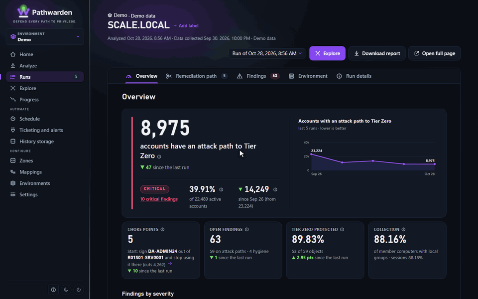

# How Pathwarden works

Pathwarden reads a collection of Active Directory and reports who can reach
Tier Zero and how, the findings, the smallest set of changes that closes
every path, and what changed since the last run.

## 1. What it reads

- SharpHound or RustHound-CE output (JSON v5 or v6), as `.json` files,
  `.zip` archives or folders. Several domains load as one graph.
- [OpenGraph files](opengraph.md) and [AzureHound files](entra.md), next to
  the AD data.

Age-based rules count from the collection time, not from today.

## 2. Tier Zero

Tier Zero is everything that controls the domain: the domains, domain
controllers and AdminSDHolder, the built-in admin groups and accounts,
krbtgt, the AD CS trust anchors and their computers, GPOs linked to Tier
Zero, management planes the directory shows (Entra Connect, SCOM, SCCM and
WSUS servers that manage domain controllers; PW-025 asks you to confirm
each), Entra Tier Zero roles with AzureHound data, and anything you add
with `tier_zero = [...]`.

Members of Tier Zero groups are Tier Zero too, except Domain Users, Domain
Computers, Authenticated Users and Everyone. One of those in an admin group
is a finding (PW-001).

A [Privilege Zone](privilege-zones.md) is another set of systems you
protect the same way, such as Tier 1 servers.

## 3. The numbers

| Term | Meaning |
|---|---|
| Accounts with an attack path to Tier Zero | The headline. Each one is a way to take over the domain. |
| Tier Zero exposure | Those accounts as a share of the active ones (logged on within `stale_days`, 90 by default). Inactive accounts don't count. |
| **Tier Zero protected** | Tier Zero objects no open attack path finding leads to: "58 of 59 objects (98.31%)". |
| Collection completeness | The share of active computers whose sessions and local groups were collected. |

## 4. Exposure and severity

**Tier Zero status** comes from the paths and the open findings:

| Status | When |
|---|---|
| Critical | Domain Users, Domain Computers, Authenticated Users, Everyone or BUILTIN\Users can reach Tier Zero, or a critical finding is open. |
| High | At least one account outside Tier Zero can reach it. |
| Moderate | No account can reach it, but findings of medium or above are open. |
| Low | No account can reach it, and nothing of medium or above is open. |

An attack path finding's **severity** follows the share of its domain that
can reach it: 95% Critical, 80% High, 40% Medium, otherwise Low. Direct
control of the domain (DCSync, control of Tier Zero objects, unconstrained
delegation, AD CS abuse) is at least High. You can change a rule's severity
in **Settings** › **Rules**.

## 5. Findings and the remediation path

The [38 rules](rules.md) report each problem where the fix happens. Each
finding has a **finding ID** that stays the same while the problem exists,
for tickets and accepted risks.

The **remediation path** is the smallest set of changes that cuts every
account off from Tier Zero, most effective first. It never proposes a
change that can't be made, such as removing Domain Users membership.
Findings it doesn't close, such as weak accounts, are marked **Fix
directly**.

## 6. Change tracking

Each analysis compares with the run history. A finding is **New**,
**Open**, **Back** (fixed earlier), **Accepted risk**, **Fixed** or **Can't
tell** (its part of the collection is missing, so it isn't closed). A failed
or much smaller collection doesn't close tickets.

The run history names accounts and computers: store it like the
collection, or [encrypt it](running.md#encrypt-the-history).

## What it doesn't cover

Azure resources, all of BloodHound CE's Cypher (`pathwarden query` runs a
part), and AD CS ESC14 and ESC15. See the
[coverage comparison](coverage.md).
