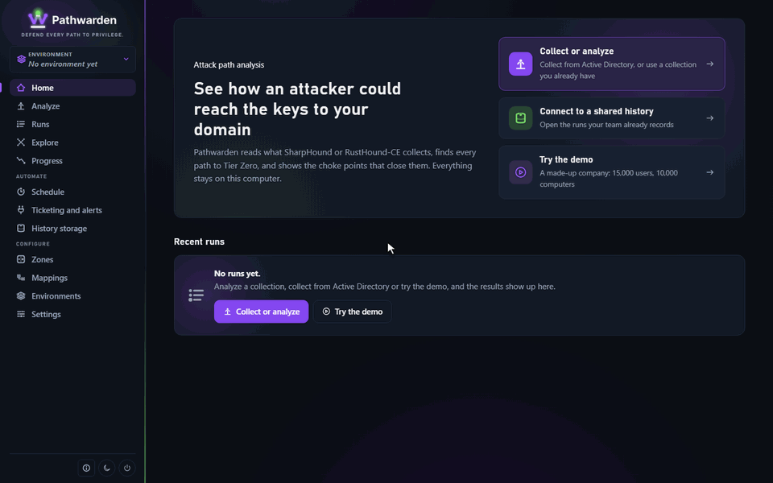

# OpenGraph data (TaskHound, MSSQLHound, ...)

Specialist collectors such as TaskHound, MSSQLHound and ConfigManBearPig
write BloodHound **OpenGraph** files. Pathwarden reads them next to your AD
collection. A file only adds attack paths through a trusted **mapping
pack**, and its findings are only marked fixed when a **coverage file**
shows the collector looked again.

## Add OpenGraph files



### In the app

1. In the rail, click **Analyze**, then **A previous collection**.
2. Add the AD collection and the OpenGraph files together.
3. Check the **Detected sources** panel: each source, its pack, and whether
   a coverage file came with it.
4. For a file without a coverage file, click **Declare what *source*
   scanned** and fill in what it scanned.
5. Click **Start analysis**.

### On the command line

```sh
pathwarden report -i corp-sharphound.zip -i taskhound_opengraph.json -o report.html
```

Files, folders and zips work, under any name. OpenGraph files alone are
not a collection. The report's **Data sources** lists each source.

A file can never set Tier Zero, domain controllers or zones, and its native
AD relationships (`MemberOf`, `GenericAll`, ...) are dropped.

## Built-in packs

| Pack | Trusted | Finding into Tier Zero |
|---|---|---|
| `taskhound` | Yes. | **PW-033**: a Tier Zero account's password is stored on a host. |
| `mssqlhound` | No. | **PW-034**: SQL Server runs as a Tier Zero account. |
| `configmanbearpig` | No. | **PW-035**: SCCM manages a Tier Zero computer. |
| `azurehound` | Yes. | **PW-031**, **PW-032** ([Entra ID](entra.md)). |

Any other trusted relationship into Tier Zero is a **PW-030** finding.
An untrusted pack's relationships show in Explore as context only.

TaskHound writes no coverage file, so its findings can open but never
resolve until you add one.

## Trust a pack

### In the app

1. In the rail, under **Configure**, click **Mappings**.
2. Open the pack and read every relationship kind marked as a path.
3. Click **Mark as trusted…** and confirm.

### On the command line

    pathwarden mappings show mssqlhound
    pathwarden mappings trust mssqlhound --reviewed

Before you trust a pack, analyze its files untrusted and check
**Data sources**: almost every AD end should resolve. Then trust it for a
test and compare the findings with what you know.

To add your own pack, list it in `pathwarden.toml` and start from a
built-in one in `crates/pathwarden-core/packs/`:

```toml
[[mapping]]
path = "packs/custom-sccm.toml"
```

## Coverage files

A coverage file tells Pathwarden which computers a collector scanned. Put
it next to the OpenGraph file as `<payload>.coverage.json`
(`taskhound.coverage.json`), in the same folder or zip:

```json
{
  "schema": "pathwarden.coverage.v1",
  "source_kind": "TaskHound",
  "payloads": [{ "file": "taskhound.json", "sha256": "<sha256 of taskhound.json>" }],
  "collector": { "name": "TaskHound", "version": "1.2.0", "via": "manual" },
  "domains": ["SCALE.LOCAL"],
  "units": { "type": "computer", "ok": ["APP01.SCALE.LOCAL", "APP02.SCALE.LOCAL"], "failed": [] },
  "complete": true,
  "asserted_by": "user"
}
```

`(Get-FileHash taskhound.json -Algorithm SHA256).Hash` gives the hash. A
file that doesn't match is ignored. List in `units.ok` only computers the
collector really read: a computer listed by mistake lets its findings be
marked fixed.

In the app, **Declare what *source* scanned** writes this file for a loose
`.json` upload.

## "Can't tell" and held findings

A finding that rests on OpenGraph data is marked fixed only when this run
read its source whole, with a matching coverage file that says `complete`
and lists every computer the finding depends on. Otherwise the finding is
held (still open) in the run history, and **Can't tell** in a retest.

When a source the last run had is missing, every attack path finding is
held, because a path may also run through that source.

## What can go wrong

| Problem | Fix |
|---|---|
| A source's relationships show only as context. | Its pack is untrusted, or no pack describes them. Review and trust the pack. |
| Findings never resolve. | Add a coverage file, or regenerate it so its hash matches. |
| Every attack path finding is held. | Add the missing source back to the analysis. |
| "read only part way". | Raise the key the warning names under `[opengraph]`. |
| The settings file doesn't load after adding a pack. | Fix the reason the error gives. |

vCenter and CyberArk have no pack: see
[vCenter and CyberArk](opengraph-vcenter-cyberark.md).
