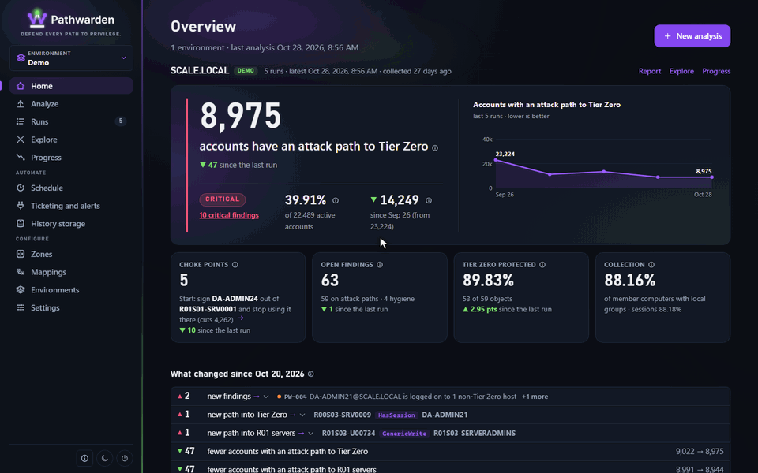

# Output plugins

`pathwarden run` hands each run's results to output plugins: tickets, chat
alerts, SIEM, email or anything you write. The
[ServiceNow](../crates/pathwarden-output-servicenow/README.md) and
[Jira](../crates/pathwarden-output-jira/README.md) plugins ship with
Pathwarden. For tools that import files instead, see
[integrations.md](integrations.md).

Output plugins run on every run. To run your own program for one finding
when someone asks (open a ticket, alert a team), add a finding action
instead: an `[[action]]` block, set up with `pathwarden action add`. Its
protocol is in [File formats](dev/formats.md#finding-actions-pathwardenaction-v1).

## Set up a plugin



### In the app

1. In the rail, under **Automate**, click **Ticketing and alerts**.
2. Click **Add ServiceNow**, **Add Jira**, or **Add a plugin program**
   (**Add a script or program** when the app was started with
   `--allow-destinations`).
3. Fill in the form and click **Save plugin**.
4. Click **Test** to run the plugin as a dry run on the latest analysis.

The ServiceNow and Jira forms have **Safety limits**: the most new tickets
one run may open (default 100) and the most open tickets one run may close,
as a percentage (default 50). A run that would go over a limit does none of
those creates or closes and says why, so a first run on a big domain or a
collection that missed a domain can't flood or empty the queue.

Some changes in the app need `pathwarden ui --allow-destinations`:

- adding a script or program;
- a plugin's instance, its Jira `project` or ServiceNow `table`,
  `allow_insecure_http` or environment variables: where findings and
  credentials go;
- turning the close limit off (100%).

Without the flag, the page can change a plugin's other settings, its
ticket fields and the safety limits. The page saves only the names of
environment variables, never their values.

The same flag is needed to change where the run history is kept on
**History storage** (another repository, branch or folder), to keep
full runs and settings in a history that isn't encrypted, and to use
**Connect to a run history**.

### On the command line

Each plugin is an `[[output]]` block in `pathwarden.toml`:

```toml
[[output]]
plugin = "servicenow"                    # runs pathwarden-output-servicenow
instance = "https://example.service-now.com"
table = "incident"

[[output]]
plugin = "teams"                         # your own script
command = ["powershell", "-NoProfile", "-File", "C:\\Pathwarden\\plugins\\teams.ps1"]
webhook_env = "PATHWARDEN_TEAMS_WEBHOOK"
```

`pathwarden plugins list|add|remove|test` edits the same blocks.

- Without `command`, Pathwarden runs `pathwarden-output-<plugin>` from its
  own folder or a `plugins` folder beside it, never from `PATH`.
- `command` must be an absolute path, or an interpreter (`powershell`,
  `pwsh`, `python`, `bash` and others) found in a folder only
  administrators can change. A script it names needs its full path too: a
  plugin starts in a private folder of its own
  (`%LOCALAPPDATA%\Pathwarden\plugin-work`), not the current folder. A
  network path or mapped network drive is refused.
- `timeout_seconds` (default 600) stops a plugin and everything it started.
- Every other key is the plugin's own setting.
- Keep secrets in environment variables named by keys ending in `_env`. A
  plugin gets only those variables and the basics (`PATH`, the temporary
  folder, the profile folders and the proxy variables), not Pathwarden's
  whole environment. Pathwarden's own secrets (the history passphrase, the
  evidence signing key, the collection password) can't be named.
- `pathwarden run --no-outputs` skips all plugins.

More: `pathwarden plugins --help`.

## Writing a plugin

A plugin is a program in any language. It gets:

- the event document (`pathwarden.event.v1`) as JSON on stdin;
- its settings as JSON in `PATHWARDEN_OUTPUT_SETTINGS`, and its name in
  `PATHWARDEN_OUTPUT_NAME`.

It writes lines to stdout and stderr, and exits 0 on success. Plugins run
once per run, after the run history is saved, so reconcile with the target
system by finding ID instead of trusting that the last run's plugin worked.
When `dry_run` is true in its settings, it must change nothing.

The event's main parts:

```json
{
  "schema": "pathwarden.event.v1",
  "run": { "run_id": "20261009T021540.231Z", "domains": ["SCALE.LOCAL"] },
  "findings": [
    { "change": "new", "fingerprint": "PW-015-...", "rule": "PW-015",
      "severity": "critical", "title": "...", "remediation": "..." }
  ],
  "resolved": [ { "fingerprint": "PW-003-...", "rule": "PW-003" } ],
  "held": [ { "fingerprint": "PW-011-...", "rule": "PW-011" } ]
}
```

- `change` is `new`, `open`, `regressed` (back) or `suppressed` (an
  accepted risk, with who accepted it in `accepted`).
- `fingerprint` is the finding ID: use it as the key in the target system.
- `held` lists findings the run couldn't check. Leave their tickets open.
- Fields are only ever added to `v1`.

Every field is in [File formats](dev/formats.md#the-event-document-pathwardeneventv1).

To test a plugin, write an event once and feed it in by hand:

```powershell
pathwarden run -i .\collect --state .\test-state --event event.json --no-outputs --no-push
$env:PATHWARDEN_OUTPUT_SETTINGS = '{"webhook_env":"PATHWARDEN_TEAMS_WEBHOOK"}'
Get-Content event.json -Raw | powershell -NoProfile -File .\plugins\teams.ps1
```
