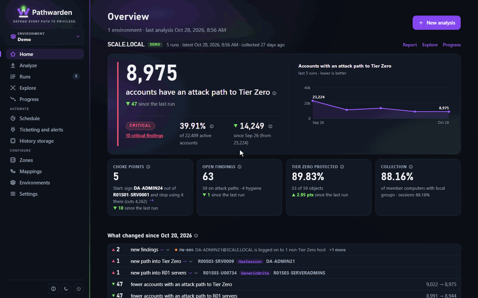

# Configuring Privilege Zones

A **Privilege Zone** is a set of objects you protect the way Pathwarden
protects Tier Zero, such as "Tier 1 servers" or a finance application. For
each zone, Pathwarden reports:

- **Exposure**: the users and computers outside the zone with an attack path
  into it.
- **Protected**: the zone objects no open attack path finding leads to.
- **PW-022 findings**: each account outside the zone that controls an object
  in it.

Tier Zero is never part of a zone, and an account that can reach Tier Zero
counts as reaching every zone. `pathwarden plan --zone` gives the
remediation path for a zone; the report and the app give it for Tier Zero
only.

## Create a zone



### In the app

1. In the rail, under **Configure**, click **Zones**, then **New zone**.
2. Type the **Zone name** and click **Next: members**.
3. Add users, computers, groups, OUs and GPOs. The **Live preview** shows
   what the zone holds and warns about entries that match nothing. Click
   **Next: review**.
4. Click **Save zone**. The zone applies from the next analysis.

### On the command line

Add the zone to `pathwarden.toml`:

```toml
[[zone]]
name = "Tier 1 servers"
groups = ["TIER1 ADMINS@SCALE.LOCAL"]
ous = ["OU=SERVERS,DC=SCALE,DC=LOCAL"]
members = ["SVC_SQL@SCALE.LOCAL"]
```

Or let `pathwarden zones add` write it, then check it:

```sh
pathwarden zones add "Tier 1 servers" --group "TIER1 ADMINS@SCALE.LOCAL" --ou "OU=SERVERS,DC=SCALE,DC=LOCAL"
pathwarden zones preview "Tier 1 servers" -i collection.zip
pathwarden posture -i collection.zip -c pathwarden.toml
pathwarden plan -i collection.zip -c pathwarden.toml --zone "Tier 1 servers"
```

More: [The app](ui.md).

## Membership

A zone is the union of its keys:

- `members`: the listed objects only.
- `groups`: the group and all its members, nested groups included.
- `ous`: the OU, everything below it, and the GPOs linked to it.

Write names as BloodHound shows them (`TIER1 ADMINS@SCALE.LOCAL`,
`SQL01.SCALE.LOCAL`, `OU=SERVERS,DC=SCALE,DC=LOCAL`), or give a SID or GUID.
Names match in any case. A zone can't be named "Tier Zero", and two zones
can't share a name.

## Planning zones

- Include the administrators of the systems, not only the systems.
  Otherwise each of their permissions shows up as a PW-022 finding.
- Prefer groups and OUs to member lists, so the zone follows changes.
- Put anything that can take over a domain controller (backup servers,
  hypervisors, password vaults) in Tier Zero with `tier_zero = [...]`, not
  in a zone.

## Checking the result

- Pathwarden warns about each entry that matches nothing, usually a typo or
  a missing `@DOMAIN`.
- A zone with far more objects than expected usually holds a group that
  nests Domain Users or Domain Computers.
- For each PW-022 finding, fix the access (`pathwarden guide PW-022`), add
  the account to the zone if it manages it, or accept the risk.

Zone administrators' logons on computers outside the zone are not reported
yet.
