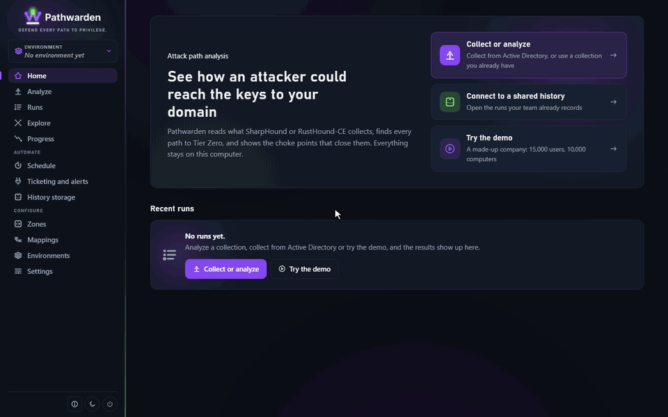
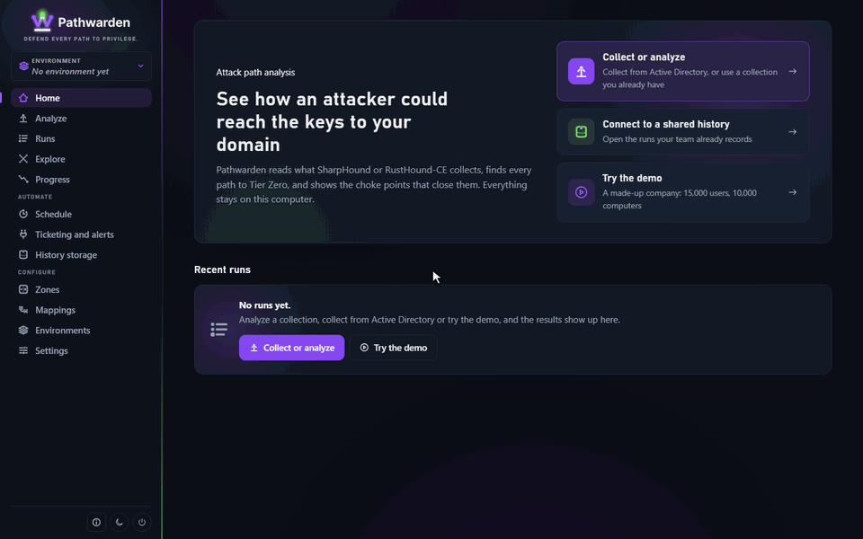
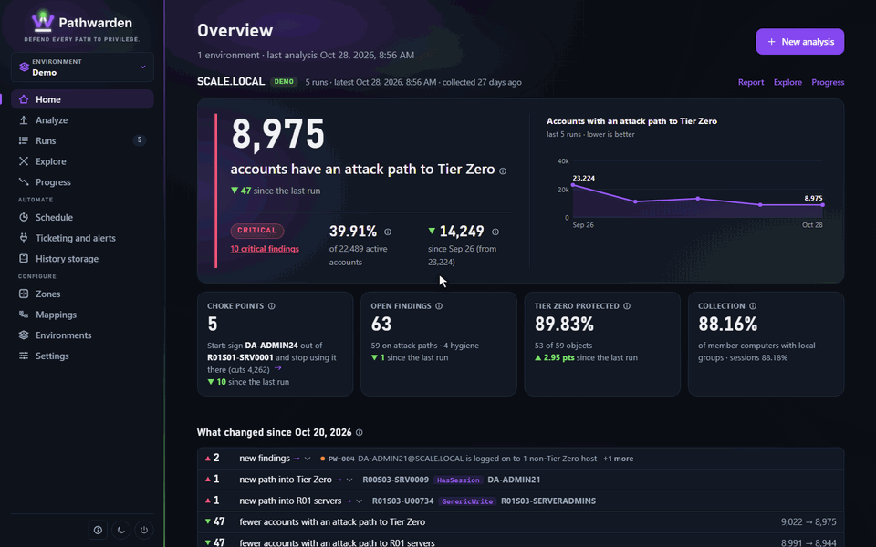
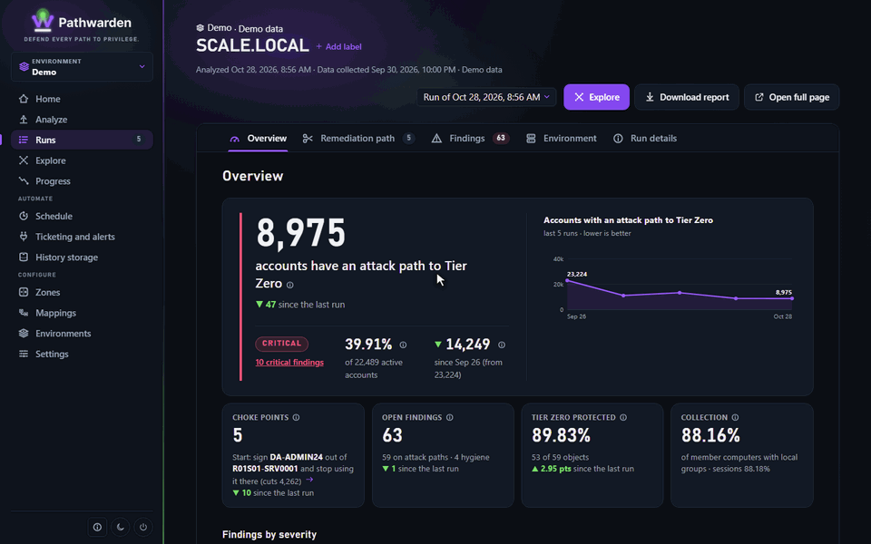
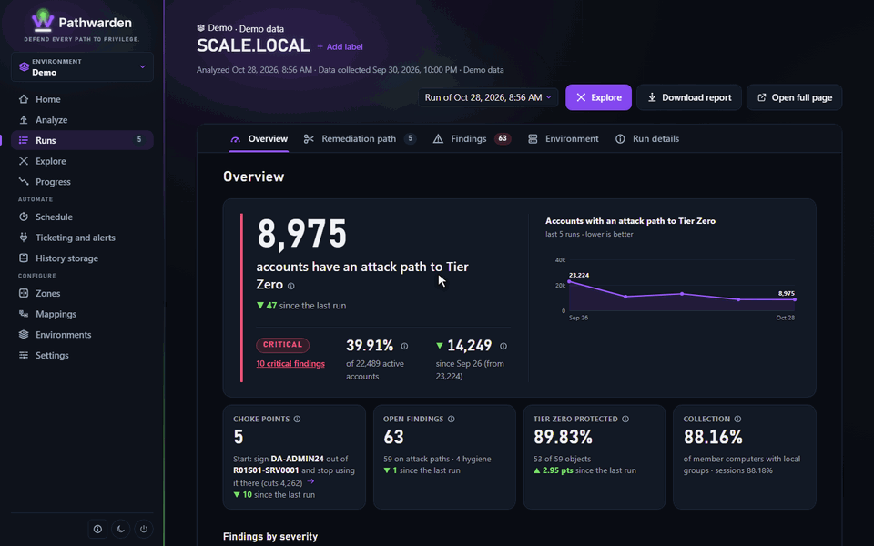
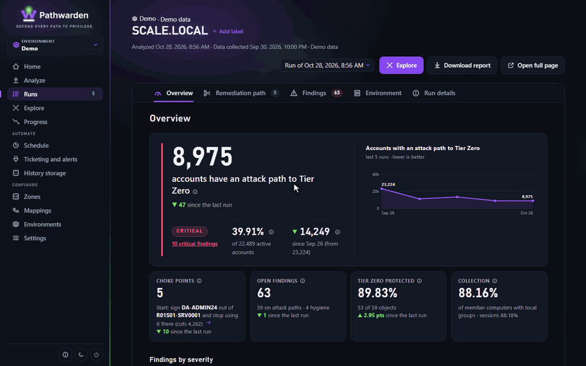
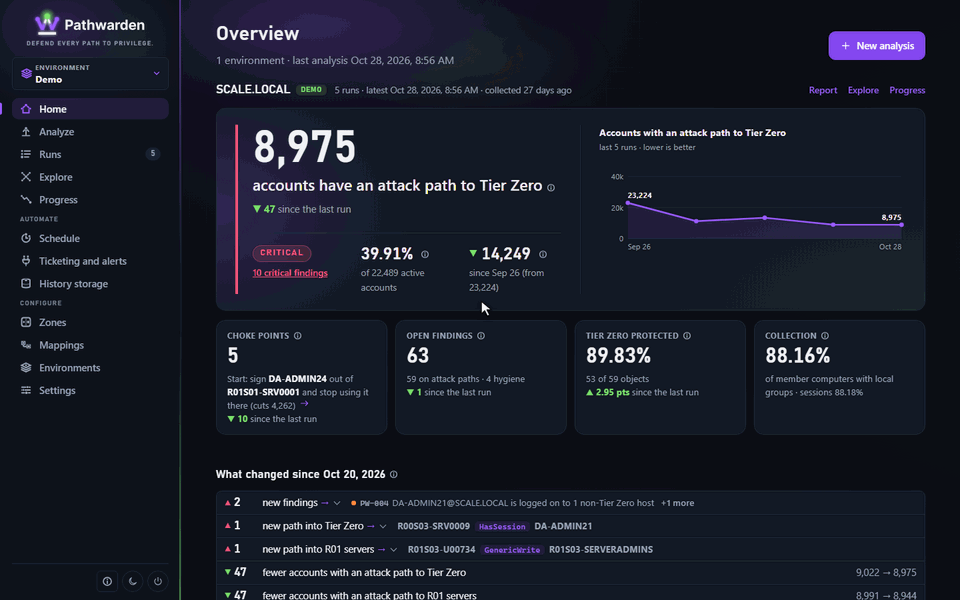
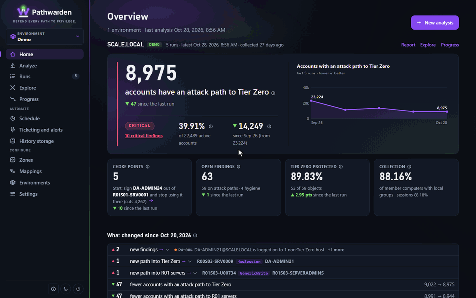
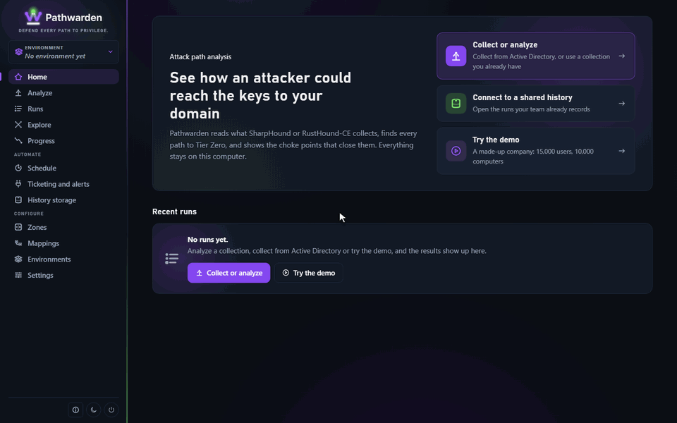
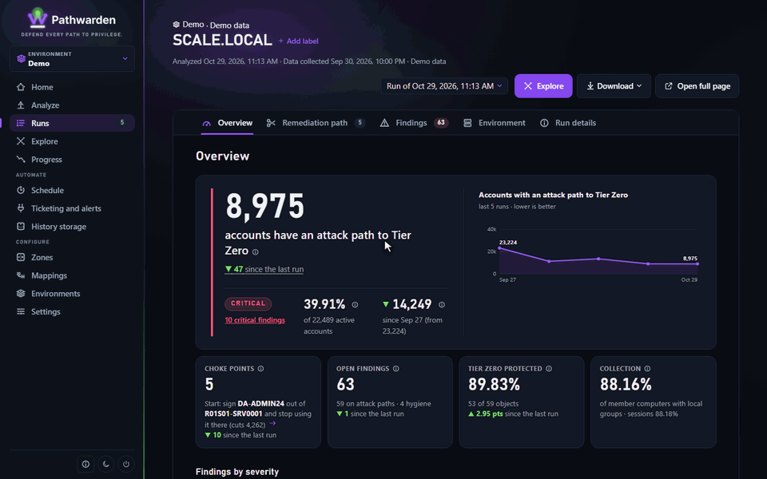

# Tasks, step by step

Each task in the app, then on the command line. Examples use the **Demo**
environment, or **Lab** where a real domain controller is needed.

## Try the demo


### In the app

1. Run `pathwarden ui`.
2. On **Home**, click **Try the demo**.
3. Wait for the analysis. The run page opens on **Overview**.

### On the command line

```sh
pathwarden demo -o demo-report.html
```

`-i demo:` reads the demo collection in any command.

## Analyze a collection



### In the app

1. In the rail, click **Analyze**, then **A previous collection**.
2. Under **1 What to analyze**, drop the `.zip` or click **browse**.
3. Under **2 Where it goes**, check the environment.
4. Click **Start analysis**.

### On the command line

```powershell
pathwarden run -i C:\Collections\20261001020000_BloodHound.zip --save
```

`--save` records the run in the environment, as the app does.

## Collect from Active Directory



### In the app

1. In the rail, click **Analyze**.
2. **Where**: check the **Domain** and the **Domain controller**. Click
   **Next**.
3. **Who**: choose **Use my Windows account** or **Enter a user and
   password**. Click **Next**.
4. **How deep**: choose **Quick** (the directory only) or **Full** (adds
   sessions and local groups). Click **Next**.
5. **Check**: wait for the check to pass. Click **Next**.
6. **Collect**: click **Start collecting**. The run page opens when the
   analysis finishes.

### On the command line

```powershell
pathwarden collect --domain scale.local --output C:\Temp\collect --save
```

Add `--scope all` for a Full collection, or `--user NAME --ldaps` for a
user and password.

More: [Collecting](collect.md).

## Read the report



### In the app

1. In the rail, click **Runs** and open a run.
2. Read **Overview**. Click the ⓘ beside a number for what it means.
3. Open **Findings**, then a finding for its attack path.
4. To share it, click **Download report**.

### On the command line

```sh
pathwarden posture -i demo:
pathwarden report  -i demo: -o report.html
```

## Follow the remediation path



### In the app

1. On a run page, open **Remediation path**.
2. Open a step for what to change and which findings it closes.
3. Open a rule's **How to fix this kind of finding** for its guide.

### On the command line

```sh
pathwarden plan -i demo: --top 5
pathwarden findings -i demo: --by-fix
pathwarden guide PW-006
```

## Retest a finding

### In the app

1. On a run page, open **Findings**.
2. Click **Retest** on the finding's row.
3. Check the **Domain** and choose **Sign in as**.
4. Click **Retest now**. The verdict is **Fixed ✓**, **Still open** or
   **Can't tell**.

### On the command line

```powershell
pathwarden retest targeted --finding PW-006-8ae0b31a46eacada --env Lab
pathwarden retest -i C:\Temp\collect --env Lab
```

More: [Retesting a finding](ui.md#retesting-a-finding).

## Accept a risk



### In the app

1. On **Findings**, open the finding.
2. Click **Accept risk**.
3. Type the **Reason** and, if needed, a **Review by** date.
4. Click **Accept risk**. It applies from the next analysis.

### On the command line

```powershell
pathwarden config risk accept --finding PW-006-5ca8fbd0a56628a3 --reason "Service account, reviewed quarterly" --review-by 2027-03-31 --env Demo
```

`--rule PW-011` in place of `--finding` accepts a whole rule.

More: [Actions on a finding](ui.md#actions-on-a-finding).

## Set a rule's severity


### In the app

1. In the rail, click **Settings**, then **Rules**.
2. Pick the rule's severity.
3. Click **Save rules**. It applies from the next analysis.

### On the command line

```sh
pathwarden config rules set --severity PW-002=critical --env Demo
```

## Explore a path



### In the app

1. On a run page, click **Explore**.
2. Click **Previous** and **Next** to page through the findings.
3. Search for an object and pick it.
4. Click **Path to Tier Zero** or **Who can reach this**.

### On the command line

```sh
pathwarden path  -i demo: --from SVC-00040@SCALE.LOCAL
pathwarden reach DA-ADMIN21@SCALE.LOCAL --env Demo
```

More: [Exploring a run](ui.md#exploring-a-run).

## Schedule nightly runs



### In the app

1. Under **Automate**, click **Schedule**, then **Windows server** or
   **Linux server**.
2. Under **Repeat the collection of**, pick a run and click **Use this
   run**.
3. Fill in **Folder on the server**, **Service account (gMSA)** or **Sign
   in as**, and **Time**. Click **Update the files**.
4. Download each file. An administrator copies them to the server and runs
   the commands shown.

### On the command line

```powershell
pathwarden schedule --domain scale.local --folder C:\Pathwarden --account 'SCALE\svc-pathwarden$' --at 02:00 --output .\schedule
```

More: [Run on a schedule](running.md#run-on-a-schedule).

## Set up ticketing



### In the app

1. Under **Automate**, click **Ticketing and alerts**, then **Add
   ServiceNow** or **Add Jira**.
2. Fill in the address and what to create:
   - ServiceNow: **Instance URL**, **Create** and **Open tickets for**.
   - Jira: **Jira address**, **Jira** (Cloud or Data Center), **Project
     key**, **Issue type** and **Open issues for**.
3. Under **Sign-in**, type the names of the environment variables that
   hold the secrets. For Jira Cloud that is your Atlassian email and an
   [API token](https://id.atlassian.com/manage-profile/security/api-tokens).
4. Check the **Safety limits** (the defaults suit most domains) and click
   **Save plugin**.
5. Set those variables where Pathwarden runs, and click **Test**.

### On the command line

```sh
pathwarden plugins add servicenow --instance https://example.service-now.com --min-severity high --env Demo
pathwarden plugins add jira --instance https://example.atlassian.net --project SEC --min-severity high --env Demo
```

Both take `--max-create` and `--max-resolve-percent` for the safety
limits.

More: [Output plugins](plugins.md).

## Keep the run history in a shared place

### In the app

1. Under **Automate**, click **History storage**, then **Start a new run
   history**.
2. Choose **A folder** and type the **Folder**, or **A git repository** and
   fill in the **Repository URL** and **Branch**. Never put a password in
   the URL.
3. Click **Save**. For git, click **Sync now**, and **Sign in** if asked.

### On the command line

```powershell
pathwarden history storage set --git https://git.example.com/sec/pathwarden-state.git --branch main
```

More: [History storage](ui.md#history-storage).

## Use environments


### In the app

1. Open the environment menu at the top of the rail, and click an
   environment to switch.
2. To add one, under **New environment**, choose **Its history**, type the
   **Name** and the **Domains**, and click **Create and switch to it**.

### On the command line

```sh
pathwarden env create "Lab" --domains "lab.scale.local" --use
```

`--env NAME` on any command uses that environment.

More: [Environments](ui.md#environments).

## Add OpenGraph or AzureHound data



### In the app

1. In the rail, click **Analyze**, then **A previous collection**.
2. Add the AD collection and the OpenGraph or AzureHound files together.
3. Check **Detected sources**, then click **Start analysis**.

### On the command line

```sh
pathwarden report -i corp-sharphound.zip -i taskhound_opengraph.json -i azurehound.json -o report.html
```

More: [OpenGraph data](opengraph.md), [Entra ID](entra.md).

## Build an evidence pack


### In the app

1. On a run page, open **Download** and choose **Evidence pack…**.
2. Under **Compared with**, pick the earlier run.
3. The first time, click **Create a key**.
4. Click **Make evidence pack**.

### On the command line

```powershell
pathwarden evidence key new
pathwarden evidence --run 20261027-191300-a1b2c3 --env Lab
```

More: [Evidence packs](evidence.md).

## Export findings



### In the app

1. On a run page, open **Download** and choose **Findings file…**.
2. Pick **SARIF 2.1.0** or **DefectDojo**.
3. Click **Download**.

### On the command line

```sh
pathwarden export sarif --run 20261027-191300-a1b2c3 --env Lab -o findings.sarif
```

More: [Integrations](integrations.md).
