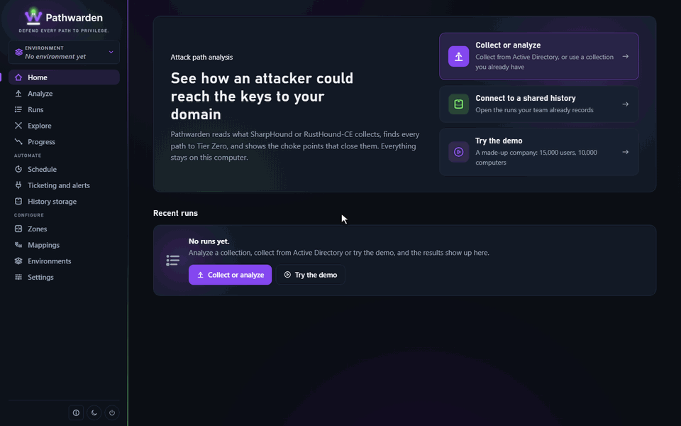

# The app

The app runs the same analysis as the command line, in a window. Step-by-step
tasks are in [tasks.md](tasks.md).



## Open the app

```powershell
pathwarden ui
```

The app opens in its own window, or in a browser with a link that works
once; press Enter in the Pathwarden window for a new one. In a browser,
click **Stop Pathwarden** at the bottom of the rail when you are done. The
app listens on 127.0.0.1 only. `pathwarden ui --help` lists the options.

### The desktop window

The Windows full release opens a native window with no network port. It
needs the WebView2 Runtime, which Windows 11 includes. On Windows Server,
install it (`winget install Microsoft.EdgeWebView2Runtime`) and run
`pathwarden ui --window`. Closing the window stops Pathwarden. On Linux there
is no window: `pathwarden ui` opens the app in your browser.

## Environments

An environment is a set of domains with its own settings, run history and
schedule. Accepted risks, zones and rules never cross between environments.

- Switch with the menu at the top of the rail.
- The first collection of a new domain makes an environment for it. A run
  goes to the environment that lists its domains. When two match, the page
  asks "Where should this run go?".
- **Change domains or remove** › **Remove environment…** moves its files to
  `environments/removed/`. Remove its schedule on the server yourself.

## Analyze or collect

Click **Analyze** in the rail, then **A previous collection** (drop a
SharpHound or RustHound-CE `.zip`) or **Collect from Active Directory**. One
job runs at a time; Home links back to it.

### The Collect wizard

1. **Where**: the domain and its domain controller. **Trusted domains**
   adds other domains to the run.
2. **Who**: **Use my Windows account** or **Enter a user and password**
   (needs **Encrypt with LDAPS (port 636)**). Leave **Kerberos only** and
   **Require SMB signing** on.
3. **How deep**: **Quick** reads the directory only. **Full** adds sessions
   and local groups from every computer.
4. **Check**: a connection check. A failure says which screen to fix.
5. **Collect**: **Start collecting**. **Keep the raw collection** keeps the
   files; **Analyze other data with it** adds AzureHound or OpenGraph files.

What each choice reads: [collect.md](collect.md#what-each-method-collects).

## Read the results

| Page | What it is for |
|---|---|
| **Home** | The latest run's status, what changed and the next step. |
| **Runs** | Every run, newest first. |
| A run's page | The report: **Overview**, **Remediation path**, **Findings**, **Collection** and **Run details**. |
| **Explore** | The run's graph. |
| **Progress** | How the environment changes from run to run. |

Above the report, **Download** gives the report, a findings file or an
evidence pack.

### Exploring a run

**Explore** opens on the run's first finding. **Previous** and **Next** page
through the findings. Search for an object and double-click it to expand
it. **Path to Tier Zero** draws its shortest path, **Who can reach this**
lists everything with a path to it, and **Query** runs **Prepared** queries
or your own **Cypher**. **Suggested zones** proposes Tier 1 and Tier 2
objects for a zone.

## Configure

**Settings** (Tier Zero additions, **Rules**, **Accepted risks**), **Zones**
and **Mappings** ([opengraph.md](opengraph.md)) edit the environment's
`pathwarden.toml`. Changes apply from the next analysis.

In a git history that keeps **Full runs and settings**, these settings are
shared, and the line under each page's title says whether they are **up to
date**. When this computer's and the shared ones both changed since this
computer last synced, the page shows both sides: **Use the shared settings**
or **Keep this computer's**. Until you choose, runs here use this
computer's. The CLI equivalents are `pathwarden config sync --use-repo` and
`--keep-local` (`--status` shows each section).

## Act on a finding

### Actions on a finding

A finding's action bar has **Retest**, **Accept risk** (a **Reason** and an
optional **Review by** date), **Add a note**, **Open in Explore** and **Copy
ID**. After the review date an accepted risk counts as open again. A
downloaded report has no actions.

### Retesting a finding

Make the change, then:

1. On the run page, click **Retest** on the finding's row.
2. Sign in as in the Collect wizard.
3. Click **Retest now**.

The row shows **Fixed ✓**, **Still open** or **Can't tell**. A retest
re-reads only the finding's objects and the computers on its path, so it
can't find a new path around them. The next collection checks everything.

## Automate

**Schedule** writes the files for a nightly run on a server; an
administrator copies them and runs the commands shown
([Schedule nightly runs](tasks.md#schedule-nightly-runs)). The page then
shows the last scheduled run and says when it is late.

**Ticketing and alerts** sends results to ServiceNow, Jira or a script.
ServiceNow and Jira each have a form, with **Safety limits** on how many
tickets one run may open or close. Give the name of an environment variable
for each secret, never the secret.

### History storage

**History storage** sets where the run history lives. The app and the
command line record into the same one.

| Choice | When to use it |
|---|---|
| **On this computer** | You work alone. |
| **Connect to a run history** | A teammate or a server already records one. |
| **Start a new run history** | You want to share runs through a folder or git. |

**What the history keeps** is **Numbers with names** (the default) or
**Full runs and settings**. **Encrypt the history with a passphrase** is
optional. **Sync now** syncs at once.

Moving the history (another repository, branch or folder), keeping full
runs in a history that isn't encrypted, and connecting to a run history
need the app started with `pathwarden ui --allow-destinations`. Without it,
use `pathwarden history storage set` or `pathwarden env create --from-git`.

### Connect to a run history

This needs `pathwarden ui --allow-destinations` (see above).

1. **Where is it?**: the repository URL and branch, or a shared folder.
   Click **Connect**. Pathwarden downloads a copy to show what the history
   holds; a large one can take a few minutes. Never put a password in the URL.
2. **What it holds**: for an encrypted history, enter the passphrase.
3. **Open and sync**: name the environment, choose **Push runs from this
   computer** or **Read only**, and click **Use this history and sync**.

With **Full runs and settings**, the first sync takes the history's shared
settings (rules, Tier Zero additions, accepted risks, zones, management
planes, mapping packs). Settings only this computer has are kept and
shared. This computer's `pathwarden.toml` is saved first, next to it, as
`pathwarden.toml.before-connect-<date>`. Runs shows one line saying what was
taken. The CLI does the same (`pathwarden env create --from-git`,
`pathwarden config sync`).

## Where your data goes

Everything stays in the workspace, private to your account:
`%LOCALAPPDATA%\Pathwarden` on Windows, `~/.local/share/pathwarden` on
Linux. Uploads are deleted after the analysis. Passwords are never saved.
The app connects only to your domain controllers, the computers a Full
collection or retest reads, and a git history's repository.

## When something goes wrong

| Problem | Fix |
|---|---|
| The link has expired. | Press Enter in the Pathwarden window for a new one. |
| The Check step fails. | Read the reason and fix that screen. |
| A retest says **Can't tell**. | Retest as a local admin on the computers it names, or collect again. |
| "Not signed in to the repository". | On **History storage**, click **Sign in**. |
| "Couldn't sync with the repository". | Check the network, then click **Sync now**. |
| "This page is out of date: reload it." | Reload and make the change again. |
| A run went to the wrong environment. | Fix the domain lists on **Environments**. |
